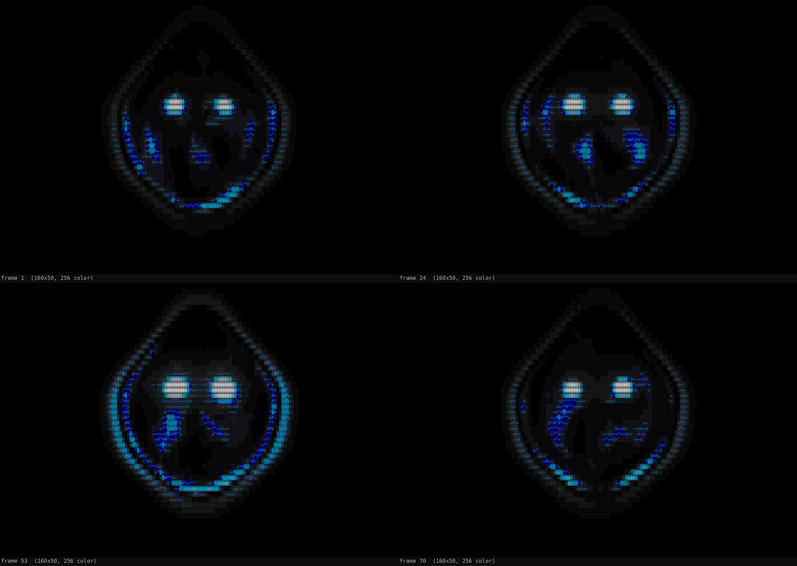
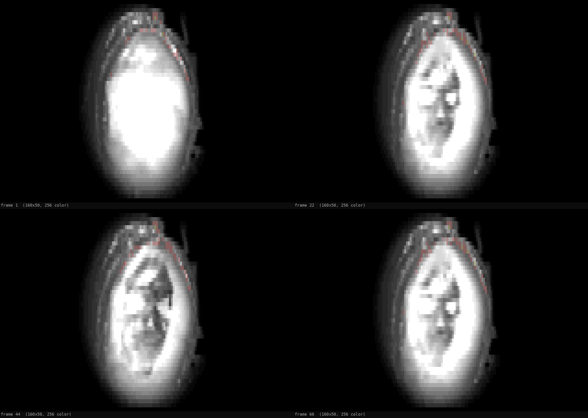

# Anubis — half-ascended `.dur` animation

A fan-made terminal animation for [Durdraw](https://github.com/cmang/durdraw), built as a
background for the [ly](https://github.com/fairyglade/ly) display manager.

The scene is Anubis from *Stargate SG-1* — specifically the "Full Circle" reveal, when he
shows Daniel Jackson that he is only partially ascended. Under the black cowl there is no
human face, just a shifting event-horizon of energy shaped into a vague skull.

The animation is a **6-second seamless loop**: a slow breathing pulse and a brighter flare
around the 3.5-second mark, then back to the resting glow.

There is also a second variant built from a short GIF of the actual episode shot
(`anubis_glow.gif`). It is photographic rather than drawn, the wooden wall of the
mothership is keyed out to black, and it loops as a forward-and-back pulse.



## Files

| File | What it is |
| --- | --- |
| `anubis-256-160x50.dur` | 256-colour version, 160×50 cells, 90 frames, 15 fps. **Recommended default.** |
| `anubis-16-160x50.dur` | 16-colour fallback, same timing and size. |
| `anubis-256-240x67.dur` | Full-screen 256-colour version for a 1920×1080 console with an 8×16 font. Larger and heavier to load. |
| `anubis-gif-256-160x50.dur` | Photographic variant built from `anubis_glow.gif`, 160×50, 86 frames, ~15 fps (5.7 s loop). Background keyed out. |
| `make_anubis.py` | Generator for the drawn scene; writes a `.dur` file. |
| `make_anubis_gif.py` | Generator for the GIF variant: keys out the background, crops, tones and samples. |
| `anubis_scene.py` | High-resolution scene renderer (numpy + Pillow). |
| `preview_dur.py` | Renders frames from a `.dur` to a PNG contact sheet. |
| `validate_dur.py` | Checks the format, row widths, colours, loop seam and Durdraw loading. |
| `test_frames.py` | Renders selected frames only, for quick visual iteration. |
| `anubis_glow.gif` | Source clip for the photographic variant (480×320, 44 frames). |
| `preview-256.png`, `preview-16.png`, `preview-256-hd.png`, `preview-gif-256.png` | Preview contact sheets. |
| `scene.png` | Full-resolution still (1280×800) of the source render, for reference. |

## Requirements

- Python 3.10+
- `numpy`
- `Pillow` (PIL)

On Arch:

```sh
sudo pacman -S python-numpy python-pillow
```

## Generate

```sh
# 256-colour, 160x50 (the defaults)
python3 make_anubis.py

# 16-colour fallback
python3 make_anubis.py --colors 16

# full-screen for 1920x1080 with an 8x16 console font
python3 make_anubis.py --width 240 --height 67 --out anubis-256-240x67.dur

# custom size / timing
python3 make_anubis.py --width 120 --height 44 --frames 60 --fps 12 --colors 256

# photographic variant from the GIF (requires anubis_glow.gif)
python3 make_anubis_gif.py
```

Options:

| Option | Default | Meaning |
| --- | --- | --- |
| `--width` | `160` | canvas columns |
| `--height` | `50` | canvas rows |
| `--frames` | `90` | number of frames |
| `--fps` | `15` | playback rate stored in the file |
| `--colors` | `256` | `256` or `16` |
| `--shade` | `mosaic` | `mosaic` fills cell backgrounds; `glyph` uses foreground characters only. `16` always uses glyph shading. |
| `--out` | `anubis-<colors>-<w>x<h>.dur` | output path |

To match your actual console, use its size in cells:

```sh
# on a real VT, or from a terminal that reports the console size
tput cols
tput lines
```

On a 1920×1080 framebuffer with the kernel's default 8×16 font that is **240×67**.

## The GIF variant

`make_anubis_gif.py` turns the reference clip `anubis_glow.gif` into
`anubis-gif-256-160x50.dur`. The source frame has a wooden wall of the mothership
behind the figure; that background is removed before sampling so the animation sits
on pure black like the drawn version.



How the background is removed:

- The wall is the only strongly warm part of the plate, so a `R − B` hue test finds
  most of it, including the dark slats.
- The mask is computed once from the average of all frames and applied to every
  frame, so the background cannot shimmer or crawl.
- The brown trim around the energy face is protected from the key: it is a costume
  detail, not background, and it sits right next to the glow.
- A soft elliptical vignette fades the remaining lit wall and the edge of the crop
  into the black canvas.

Because the source is photographic and often blown out, this variant uses solid
colour blocks rather than glyph shading; the glyph ramp only adds noise on a soft
face. It therefore needs **256 colours** (`full_color = true` in ly). The 16-colour
palette cannot represent it.

The GIF ends on the revealed face and cuts back to a white flare, so played as-is it
would flash every three seconds. By default the clip is played forward and then
backward, which makes the energy flare, reveal the face, and settle again as a
seamless 5.7-second loop. Use `--loop-mode cut` for the original order.

| Option | Default | Meaning |
| --- | --- | --- |
| `--gif` | `anubis_glow.gif` | source clip |
| `--width`, `--height` | `160`, `50` | canvas cells |
| `--crop` | `80,0,332,320` | `left,top,right,bottom` in source pixels |
| `--shade` | `blocks` | `blocks` (solid cells), `mosaic` (glyph texture), `glyph` |
| `--tone` | `0.0,0.90,1.25` | luminance curve: `offset,scale,gamma` |
| `--sharpen` | `8,0.9` | unsharp mask `radius,amount` (luminance only) |
| `--margin` | `0.02` | fraction of canvas height left free |
| `--loop-mode` | `pingpong` | `pingpong` or `cut` |
| `--no-vignette` | off | do not fade the portrait edges into black |
| `--out` | `anubis-gif-256-<w>x<h>.dur` | output path |

## Preview and validate

```sh
python3 preview_dur.py anubis-256-160x50.dur preview-256.png --frames 1,24,53,70
python3 preview_dur.py anubis-gif-256-160x50.dur preview-gif-256.png --frames 1,22,44,66
python3 validate_dur.py anubis-256-160x50.dur anubis-16-160x50.dur --scene-loop
python3 validate_dur.py anubis-gif-256-160x50.dur
```

`validate_dur.py` uses Durdraw's own `open_json_dur_file()` so it catches parser
issues, not just structural ones. It always reports the colour difference across the
loop seam; `--scene-loop` additionally re-renders frame 0 and frame N of the drawn
scene and requires an exact match (that check only applies to `make_anubis.py`
output).

## Install for ly

```sh
sudo install -m 644 anubis-256-160x50.dur /etc/ly/anubis.dur
sudoedit /etc/ly/config.ini
```

Set these options:

```ini
animation = dur_file
dur_file_path = /etc/ly/anubis.dur
animation_frame_delay = 5
animation_timeout_sec = 0

dur_offset_alignment = center
dur_x_offset = 0
dur_y_offset = 0

full_color = true
blank_box = false
```

Why these matter:

- **`full_color = true`** is required for a 256-colour `.dur`. ly 1.4.1 refuses a
  256-colour file when `full_color = false`. If you must run in 16-colour mode, use
  `anubis-16-160x50.dur` instead; the GIF variant has no 16-colour version.
- **`blank_box = false`** makes the login box transparent, so the face is not hidden
  behind a filled rectangle. The box border and text are still drawn on top of the
  animation.
- **`animation_timeout_sec = 0`** keeps it running forever.
- **`dur_offset_alignment = center`** centres the art. Use `dur_y_offset` if you want to
  move it up or down, for example `dur_y_offset = -3` to lift the face above the login
  box.
- **`animation_frame_delay`** is the widget update interval in milliseconds; `5` is fine.
  The actual frame rate comes from the `.dur` file (`framerate`), so 90 frames at 15 fps
  is a 6-second loop.

After saving, restart ly (or log out to the display manager):

```sh
sudo systemctl restart ly
```

If ly rejects the file, check `/var/log/ly.log`. The most common causes are an
unsupported `formatVersion`, a 256-colour file with `full_color = false`, or a
`dur_file_path` pointing at the wrong file.

## Notes on the format

These files are gzipped JSON, **Durdraw format version 7** — the version ly 1.4.x
accepts. The generator handles the quirks that are easy to get wrong:

- `contents[y][x]` is row-major, and every row is exactly `sizeX` codepoints.
- `colorMap[x][y]` is **column-major** in v7, with `[fg, bg]` per cell.
- The files are ASCII-only, so a Linux console font cannot turn characters into `#`.
- 256-colour files use only xterm indices ≥ 16. ly maps indices 0–15 through an
  ANSI-ordered table, while Durdraw stores them in a different order; staying in the
  6×6×6 cube and the grayscale ramp avoids the mismatch entirely.
- In the drawn scene every time-dependent term completes an integer number of cycles
  over the frame count, so frame 0 and frame N are identical and the loop has no
  visible seam. The GIF variant gets its seamlessness from the ping-pong ordering.

The drawn animation uses `mosaic` shading in 256-colour mode: cell backgrounds carry
the smooth colour field and foreground glyphs add texture. 16-colour mode falls back
to classic ANSI-style glyph shading, because nearest-colour mapping turns the soft
cowl into a flat gray slab. The GIF variant uses `blocks` shading: solid cell
backgrounds, no glyphs.

## Credits

Fan art. *Stargate SG-1* and Anubis are the property of MGM. This project only
redistributes original generated artwork and code.
